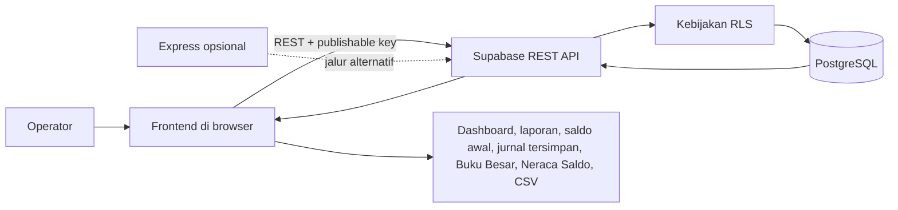
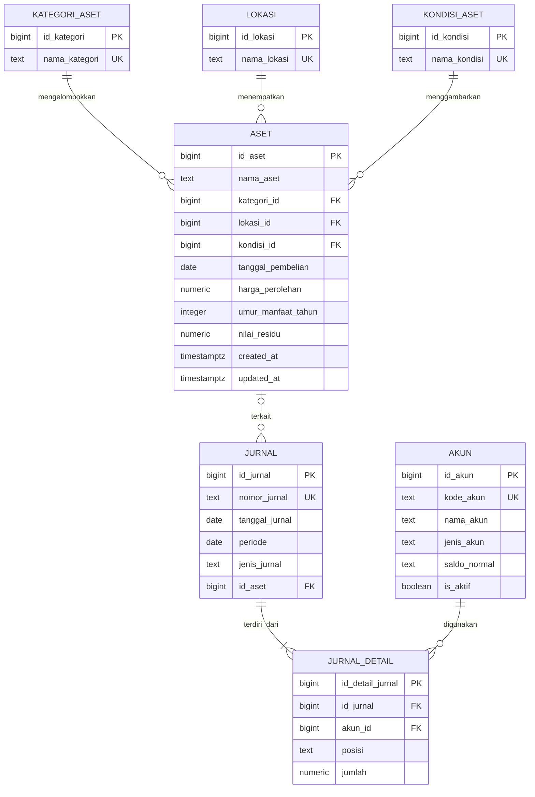

<div align="center">

# FEBRINA-ASSET

**Sistem Informasi Pencatatan Aset Tetap**  
Inventaris, penyusutan, dan pelaporan aset Febrina's Catering.


</div>

## Tentang Proyek

FEBRINA-ASSET adalah aplikasi web untuk mencatat aset tetap Febrina's Catering dan mendukung pembukuannya. Sistem mencakup inventaris, bagan akun, saldo awal, jurnal perolehan, penyusutan, Buku Besar, dan Neraca Saldo. Data disimpan di PostgreSQL melalui Supabase.

> **Cakupan akuntansi:** saldo awal, jurnal perolehan, dan jurnal penyusutan bulanan tersimpan sebagai jurnal berpasangan. Buku Besar dan Neraca Saldo merangkum jurnal tersimpan; transaksi selain aset tetap belum dicatat.

## Daftar Isi

- [Fitur](#fitur)
- [Teknologi dan Arsitektur](#teknologi-dan-arsitektur)
- [Menjalankan Aplikasi](#menjalankan-aplikasi)
- [ERD](#erd)
- [Jalankan Frontend](#jalankan-frontend)
- [Backend Express Opsional](#backend-express-opsional)
- [Perhitungan Penyusutan](#perhitungan-penyusutan)
- [Keamanan dan Batasan](#keamanan-dan-batasan)
- [Struktur Proyek](#struktur-proyek)
- [Dokumentasi](#dokumentasi)

## Fitur

- Mencatat, mengubah, dan menghapus aset tetap.
- Mengelola bagan akun dengan kode, jenis, saldo normal, serta status aktif.
- Mencatat satu jurnal saldo awal yang seimbang sebelum transaksi pertama.
- Mencatat jurnal perolehan aset secara permanen dengan debit-kredit seimbang dan pencegahan jurnal ganda per aset.
- Menampilkan kategori, lokasi, kondisi, tanggal pembelian, dan harga perolehan.
- Mencari aset serta memfilter berdasarkan kondisi.
- Menandai aset yang rusak atau memerlukan perbaikan.
- Menghitung penyusutan garis lurus dan estimasi nilai buku jika umur manfaat sudah diisi.
- Menampilkan laporan aset dan penyusutan berdasarkan periode bulanan yang dipilih.
- Menampilkan serta mencetak pratinjau jurnal penyusutan dengan total debit dan kredit.
- Memposting jurnal penyusutan bulanan secara atomik dan mencegah posting ganda untuk periode yang sama.
- Menampilkan Buku Besar per periode dan Neraca Saldo kumulatif dari jurnal tersimpan.
- Mengekspor aset yang sedang ditampilkan ke CSV.

## Teknologi dan Arsitektur

- **Frontend:** HTML, CSS, JavaScript.
- **Database dan API utama:** Supabase, PostgreSQL, Supabase REST API.
- **Backend alternatif:** Node.js, Express, `@supabase/supabase-js`.

Frontend saat ini mengakses Supabase secara langsung. Backend Express tersedia sebagai jalur alternatif, tetapi belum digunakan oleh frontend.



Data aset, akun, dan jurnal tersimpan di database. Saldo awal, jurnal perolehan, serta posting penyusutan ditulis atomik melalui fungsi PostgreSQL; Buku Besar/Neraca Saldo membaca jurnal tersimpan. Pratinjau penyusutan, dashboard, laporan aset, pencarian, filter, dan ekspor CSV dihitung di browser.

## Menjalankan Aplikasi

1. Buat proyek Supabase dan buka **SQL Editor**.
2. Jalankan seluruh isi `backend/sql/database.sql` untuk membuat atau memperbarui tabel, kebijakan akses, indeks, fungsi jurnal, dan data referensi awal. Skrip ini dapat dijalankan ulang.
3. Muat ulang schema cache Supabase jika endpoint baru belum dikenali, lalu pastikan URL proyek dan publishable key tersedia untuk konfigurasi frontend.

Tabel utama:

- `aset`: data aset dan foreign key kategori, lokasi, serta kondisi.
- `kategori_aset`: daftar kategori.
- `lokasi`: daftar lokasi aset.
- `kondisi_aset`: daftar kondisi aset.
- `akun`: bagan akun dengan jenis akun, saldo normal, dan status aktif.
- `jurnal`: header jurnal perolehan/penyusutan, tanggal transaksi, nomor, aset, dan periode penyusutan.
- `jurnal_detail`: baris debit dan kredit yang terhubung ke akun.

Kolom penyusutan pada `aset` adalah `umur_manfaat_tahun` dan `nilai_residu`. Nilai residu tidak boleh negatif atau melebihi harga perolehan. Umur manfaat, jika diisi, harus antara 1 dan 100 tahun.

## ERD



Setiap aset wajib memiliki satu kategori, satu lokasi, dan satu kondisi. Satu record referensi dapat dipakai banyak aset atau belum dipakai. Relasi menggunakan `ON UPDATE CASCADE` dan `ON DELETE RESTRICT`.

## Jalankan Frontend

Atur `SUPABASE_URL` dan `SUPABASE_PUBLISHABLE_KEY` di bagian konfigurasi `frontend/js/script.js` sesuai proyek Supabase Anda. Gunakan publishable key, bukan service-role key.

Sajikan folder `frontend` menggunakan server web statis. Contoh jika Node.js tersedia:

```powershell
npx serve frontend
```

Buka URL lokal yang ditampilkan server. Anda juga dapat memakai ekstensi server statis di VS Code. Membuka HTML melalui `file://` tidak disarankan karena perilaku permintaan browser dapat berbeda.

## Backend Express Opsional

Backend hanya diperlukan jika aplikasi akan diarahkan untuk menggunakan endpoint Express. Siapkan Node.js, instal dependensi dari root proyek, lalu atur variabel lingkungan Supabase:

```powershell
npm init -y
npm install express @supabase/supabase-js
$env:SUPABASE_URL = 'https://PROJECT-REF.supabase.co'
$env:SUPABASE_SERVICE_ROLE_KEY = 'ISI_DI_ENVIRONMENT_SERVER'
node backend/app.js
```

Server berjalan pada port `3000` secara default; atur `PORT` untuk menggunakan port lain. Endpoint yang tersedia:

- `GET /api/referensi`
- `GET /api/aset`
- `POST /api/aset`
- `PATCH /api/aset/:id`
- `DELETE /api/aset/:id`

> **Penting:** service-role key memiliki hak akses tinggi. Simpan hanya di environment server, jangan masukkan ke frontend atau commit ke repositori. Frontend saat ini belum memanggil endpoint Express.

API Express saat ini hanya memvalidasi dan menyimpan atribut dasar aset. Untuk pengalaman lengkap (termasuk umur manfaat dan nilai residu), gunakan integrasi Supabase REST yang saat ini dipakai frontend, atau perluas API Express sebelum mengalihkan frontend ke sana.

## Perhitungan Penyusutan

Perhitungan dilakukan di browser dan merupakan estimasi berdasarkan tanggal saat halaman dibuka:

```text
Dasar penyusutan = harga perolehan - nilai residu
Penyusutan per bulan = dasar penyusutan / (umur manfaat dalam tahun x 12)
Nilai buku = harga perolehan - akumulasi penyusutan
```

Tanpa umur manfaat, nilai penyusutan dan nilai buku tidak ditampilkan. Laporan dapat ditampilkan untuk bulan yang dipilih dan dicetak. Pratinjau jurnal menghitung beban periode dari perubahan akumulasi penyusutan antara akhir bulan sebelumnya dan akhir bulan terpilih; penyusutan dimulai pada bulan setelah pembelian.

Saldo awal dicatat satu kali melalui menu **Saldo Awal**. Setiap nominal harus mengikuti saldo normal akun, total debit harus sama dengan total kredit, dan tanggalnya harus sebelum transaksi pertama. Jurnal dibuat melalui `catat_saldo_awal` tanpa tabel baru.

Jurnal perolehan tersimpan permanen dan dibuat atomik oleh `catat_jurnal_perolehan`. Harga dan tanggal diambil dari record aset; akun aset serta akun sumber (Kas/Bank atau Liabilitas) harus aktif, dan indeks unik mencegah lebih dari satu jurnal perolehan untuk aset yang sama. Aset lama tidak dijurnal otomatis; pilih dan catat melalui menu Jurnal Perolehan.

Pratinjau jurnal penyusutan dihitung di browser. Tombol **Posting jurnal** menyimpan beban periode ke akun Beban Penyusutan dan Akumulasi Penyusutan melalui `posting_jurnal_penyusutan`; fungsi ini memakai tanggal serta rumus akumulasi yang sama, menyimpan debit-kredit atomik, dan hanya mengizinkan satu posting per bulan.

Buku Besar menampilkan mutasi pada bulan terpilih. Neraca Saldo menghitung saldo kumulatif dari jurnal tersimpan sampai akhir periode dan memeriksa keseimbangan debit-kredit, termasuk jurnal saldo awal jika sudah dicatat.

## Keamanan dan Batasan

- Form masuk yang tersedia adalah **demo login sisi klien**, bukan autentikasi. Nilai demo berada di kode frontend dan dapat dilihat siapa pun; form ini tidak melindungi API atau database.
- Kebijakan pada `backend/sql/database.sql` memberi role Supabase `anon` hak baca tabel referensi/jurnal, CRUD pada akun/aset, serta akses ke fungsi RPC jurnal. Operasi database belum dibatasi berdasarkan pengguna yang login.
- Jangan memakai konfigurasi akses saat ini untuk data produksi atau mempublikasikan data sensitif. Sebelum deployment publik, gunakan Supabase Auth atau autentikasi server, batasi policy RLS ke pengguna berwenang, tinjau hak eksekusi RPC, dan hapus atau ganti kredensial demo.
- Publishable key memang digunakan pada frontend Supabase, tetapi **service-role key tidak boleh** dimasukkan ke frontend atau commit ke repositori.
- Aplikasi belum menyediakan pencatatan transaksi usaha umum, pemasok, bukti pembelian, atau laporan keuangan menyeluruh.

## Struktur Proyek

```text
backend/
├── app.js
└── sql/
    └── database.sql
frontend/
├── css/
│   └── style.css
├── html/
│   └── index.html
└── js/
    └── script.js
README.md
Deskripsi_SIA_Pencatatan_Aset_Tetap_Febrinas_Catering.docx
Laporan_UTS_Pencatatan_Aset_Tetap_Febrinas_Catering.pdf
```

## Dokumentasi

- [Deskripsi sistem, skema, flowchart, dan ERD (DOCX)](Deskripsi_SIA_Pencatatan_Aset_Tetap_Febrinas_Catering.docx)
- [Laporan UTS (PDF)](Laporan_UTS_Pencatatan_Aset_Tetap_Febrinas_Catering.pdf)